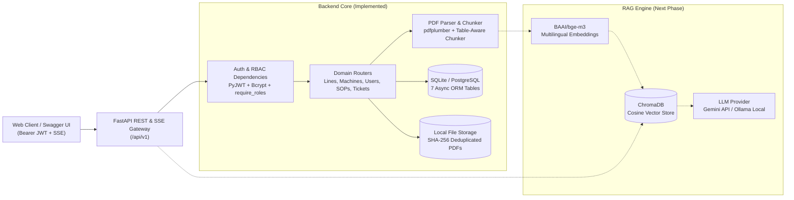
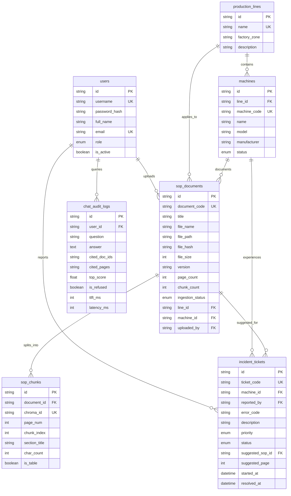
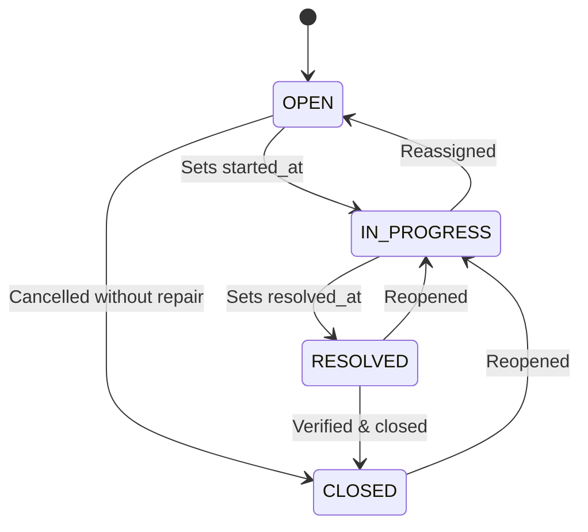

# SmartSOP AI — System Architecture & Design

This document describes the current backend architecture, relational database schema, role-based access control (RBAC) matrix, incident lifecycle rules, and document ingestion pipeline for SmartSOP AI.

---

## 1. High-Level System Architecture

---

## 2. Relational Database Schema (7 Tables)

All tables use string UUID primary keys (`String(36)`) and UTC timestamp tracking (`created_at`, `updated_at`) via SQLAlchemy 2.0 async models.

> **Retention Design:** Deleting a `User` preserves factory incident history and chat logs via `ondelete="SET NULL"` rather than cascading deletes.

---

## 3. Role-Based Access Control (RBAC) Matrix

Access control is enforced at the FastAPI router/endpoint level via `require_roles([...])`:

| Resource / Action | `OPERATOR` | `SHIFT_ENGINEER` | `FACTORY_MANAGER` | `ADMIN` |
| :--- | :---: | :---: | :---: | :---: |
| Login & View Own Profile | Yes | Yes | Yes | Yes |
| View Lines, Machines, Tickets & SOP List | Yes | Yes | Yes | Yes |
| Stream Authenticated PDF (`/sop_documents/{id}/file`) | Yes | Yes | Yes | Yes |
| Create & Update Incident Tickets | No (`403`) | Yes | Yes | Yes |
| Create / Update Production Lines & Machines | No (`403`) | Yes | Yes | Yes |
| Upload & Update SOP Metadata | No (`403`) | No (`403`) | Yes | Yes |
| Delete Lines, Machines, Tickets, SOPs | No (`403`) | No (`403`) | No (`403`) | Yes |
| Manage Users (`/users` CRUD) | No (`403`) | No (`403`) | No (`403`) | Yes |

---

## 4. Incident Ticket State Machine

To ensure accurate Mean Time To Repair (MTTR) metrics (`resolved_at - started_at`), `PATCH /api/v1/incident_tickets/{id}` enforces strict status transitions:

Direct jumps from `OPEN` to `RESOLVED` are rejected with `HTTP 400 Bad Request`.

---

## 5. Table-Aware PDF Ingestion Pipeline

Industrial SOPs frequently embed alarm code matrices inside multi-page PDF tables. Standard fixed-size character splitting breaks rows and separates error codes from column headers. SmartSOP AI prevents this with a two-stage pipeline:

1. **Extraction (`backend/app/utils/pdf_parser.py`):**
   * Extracts per-page text and tables using `pdfplumber`.
   * Formats each table as standard Markdown (`| Col 1 | Col 2 |`) and detects continuation tables across page boundaries (inheriting headers when a page starts directly with an error-code row).
   * Identifies structural headings (`H1`/`H2`/`H3`) using font size and numbering patterns.
2. **Table-Aware Chunking (`backend/app/utils/chunker.py`):**
   * Prose sections are split via `RecursiveCharacterTextSplitter` (`chunk_size=800`, `chunk_overlap=150`, heading-first separators).
   * Short tables (`<= 2000` chars) stay intact in a single chunk (`is_table=True`).
   * Long tables are grouped by complete rows, repeating the Markdown header and separator line at the top of every chunk.
